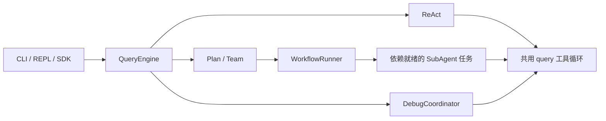
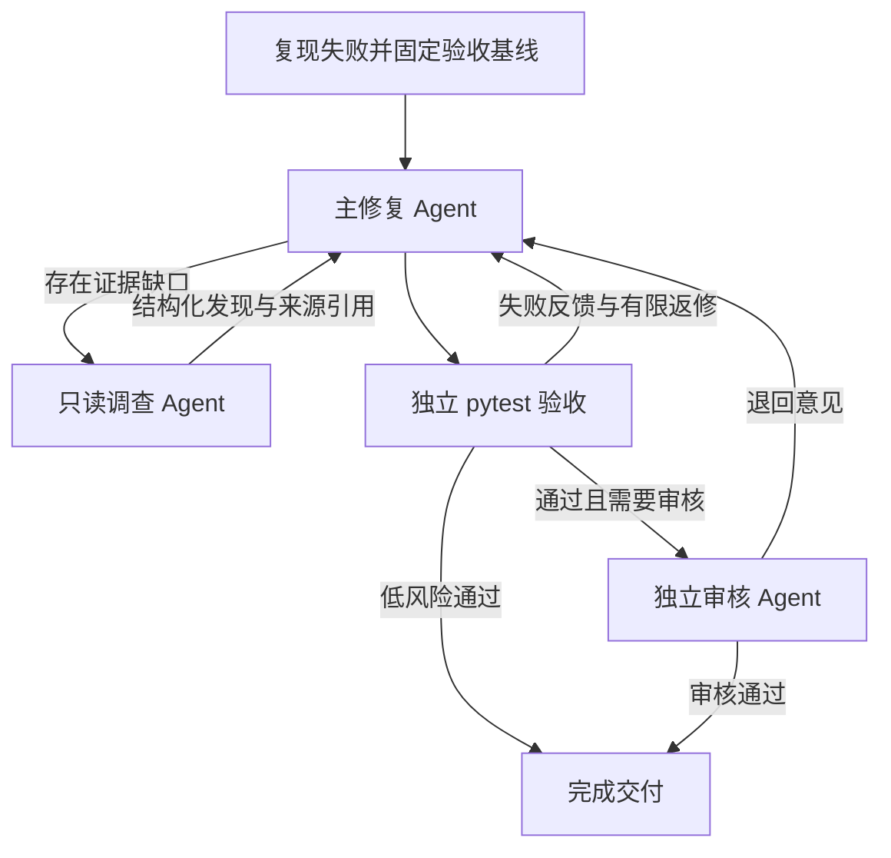

# PaiCLI

**在本地 Python 项目中复现故障、协作修复，并用已有测试独立验收。**

[](pyproject.toml)
[](LICENSE)

PaiCLI 是一个终端 Agent 工具，提供 CLI、交互会话和 Python SDK。项目基于开源 PaiCLI 二次开发，重构了执行循环与任务调度，增加面向 Python 缺陷修复的 Debug 工作流。开发者指定目标目录、故障描述和已有 pytest 用例，系统保存失败基线、调查和修改源码，再根据真实测试结果决定返修或交付。

适合已有测试的个人项目排障，也可以用 ReAct、Plan、Team 模式阅读代码、拆分任务和协作分析。

**核心技术**：Python、LangGraph、asyncio、Tool Calling、MCP、SQLite/FTS5、FastEmbed（多语 E5）、pytest、HTTPX。

[快速开始](#快速开始) · [执行模式](#执行模式) · [Debug 工作流](#debug-工作流) · [项目资料检索](#项目资料检索) · [Python SDK](#python-sdk) · [项目结构](#项目结构)

## 可以做什么

| 能力 | 实现方式 |
| --- | --- |
| 多 Agent 协作 | Plan/Team 共用 LangGraph 调度器，按任务 DAG 分派，只读任务有界并行，写入任务独占执行 |
| 受控修复 | 主修复 Agent 按需委派只读调查，高风险补丁通过测试后进入独立审核 |
| 回归验收 | 固定测试和执行条件，检查目标失败用例转为通过，以及原通过用例保持通过 |
| 可回查证据 | 原始工具输出和测试结果落盘，角色结论关联来源、行号与源码版本 |
| 长任务控制 | Debug 跨角色共享预算，支持取消、阶段 Checkpoint、文件核对与同编号续作 |
| 上下文和记忆 | 滑动窗口、提取式历史摘要、按引用回读，以及按项目隔离的 SQLite 记忆 |
| 项目资料 RAG | 使用本地多语 E5、FTS5/BM25 与 RRF 检索项目规范和排障手册 |
| 工具接入 | 提供文件、搜索与命令工具，通过 MCP 扩展外部能力 |

## 快速开始

需要 Python 3.11 或以上版本及 [uv](https://docs.astral.sh/uv/)。以下命令使用 PowerShell，在仓库根目录运行。

```powershell
git clone https://github.com/dbfbd/paicli-python.git
cd paicli-python
uv sync --locked --extra dev
$env:DEEPSEEK_API_KEY = 'your-key'
uv run --locked --extra dev paicli doctor
```

默认使用 DeepSeek。模型与工具选项可通过用户级 `~/.paicli/config.json` 或目标项目的 `.paicli/config.json` 配置。

### 修复一个已有失败的测试

把下面的项目目录、测试文件和故障描述替换为自己的内容。`--tests` 相对于目标项目解析。

```powershell
uv run --locked --extra dev paicli debug --cwd ../your-project --tests tests/test_example.py -p '修复当前失败用例，保留已有接口和其他通过行为' --json
```

目标项目中存在 `.venv` 时，Debug 优先使用该环境运行 pytest。请在该环境安装项目依赖和 pytest。可重复传入 `--tests` 指定多个目标。

最终结果包含运行编号、状态、测试验收信息和用量。`completed` 表示通过了本次任务所要求的验收与审核。

### 进入交互会话

```powershell
uv run --locked --extra dev paicli --cwd ../your-project
```

```text
概述这个项目的模块和入口
/plan 分别梳理核心模块，并汇总依赖关系
/team 检查核心模块中的输入校验与异常处理
/debug tests/test_example.py :: 描述故障与预期行为
/help
```

`/debug` 使用两侧带空格的 ` :: ` 分隔测试目标和故障描述。

## 执行模式

| 模式 | 适用任务 | 执行入口 |
| --- | --- | --- |
| ReAct | 直接阅读、搜索和完成边界明确的小任务 | `paicli -p '任务'` |
| Plan | 先生成带依赖的计划，再执行子任务 | `paicli --mode plan -p '任务'` |
| Team | 规划、工作和评审角色协作 | `paicli --mode team -p '任务'` |
| Debug | 根据已有失败测试定位、修改并独立验收 Python 源码 | `paicli debug --tests ... -p '故障'` |

模式由命令或交互入口显式选择。Plan/Team 的子任务依赖构成 DAG，外层 LangGraph 持续调度，局部审核拒绝可以触发有限重试。



## Debug 工作流



主修复 Agent 保留修复会话。互不重叠的调查最多两个并行，重叠范围会合并。调查结论携带证据引用，程序核对产物完整性和对应源码版本。

Harness 在工具执行层限制权限与写入范围。Debug 允许修改项目中已有的应用 Python 文件，测试、配置与依赖清单受保护。同一项目的 Debug 任务通过文件锁协调写入。

独立 pytest Verifier 检查目标失败用例是否转为通过（F2P），以及基线中已通过的用例是否保持通过（P2P）。失败信息或审核意见会送回修复会话。连续返修根据补丁、失败用例和源码证据检测停滞，先收敛到主修复 Agent，仍无进展则结束。

### 预算、取消与阶段恢复

```powershell
uv run --locked --extra dev paicli debug --cwd ../your-project --tests tests/test_example.py -p '描述故障' --max-models 24 --max-tools 48 --max-tokens 160000
uv run --locked --extra dev paicli runs list
uv run --locked --extra dev paicli runs show RUN_ID
uv run --locked --extra dev paicli runs cancel RUN_ID
uv run --locked --extra dev paicli debug --resume RUN_ID
```

将 `RUN_ID` 替换为实际运行编号。Checkpoint 保存已完成阶段、消息历史、文件信息和证据引用。恢复时核对工作区，沿用原目标、验收与累计用量。可在恢复命令上增加 `--max-models 40` 等选项显式提高预算。

预算在新增请求前检查，最后一个在途请求的实际用量可能超过门槛。调查超时可交回已有证据，补丁通过测试但必要审核未完成时，会保留为待审核状态供续作。

### 单独使用测试验收

可以自行修改源码，再使用同一套基线与验收机制。

```powershell
uv run --locked --extra dev paicli verify baseline tests/test_example.py --cwd ../your-project --json
uv run --locked --extra dev paicli verify check BASELINE_RUN_ID --json
```

两条命令之间完成源码修改，第二条使用第一条返回的基线编号。

## 项目资料检索

修复需要参考项目约定、接口规范或排障手册时，可以显式建立资料索引。

```powershell
uv sync --locked --extra dev --extra retrieval
uv run --locked --extra dev --extra retrieval paicli knowledge index docs --cwd ../your-project
uv run --locked --extra dev --extra retrieval paicli knowledge search '重复请求如何处理' --cwd ../your-project --k 3
uv run --locked --extra dev --extra retrieval paicli debug --cwd ../your-project --tests tests/test_example.py -p '描述故障' --knowledge
```

`docs` 应替换为项目内的 Markdown、TXT、RST 文件或目录。首次建索引下载本地多语 E5 模型。检索经 RRF 融合后返回路径、行号和文件哈希，过滤已变化的来源。文档更新后重新运行建索引命令。

Debug 在故障复现后按需检索资料，角色共享这组引用。源码通过文件工具即时读取，修复结果由测试验收。索引缺失或检索不可用时，程序记录状态并继续调试。

## 上下文、记忆与工具

- **上下文**按完整工具批次保留近期消息，旧历史生成提取式摘要，保留任务目标和证据引用。长输出落盘供后续回读。
- **项目记忆**以 SQLite 按项目保存偏好与约束，匹配采用有容量限制的 LRU/TTL 缓存，记录更新后失效。
- **MCP Client**读取用户级或项目级 `.paicli/mcp.json`，连接、握手和请求受超时控制，单个服务加载失败时保留其他工具。
- **工具错误反馈**区分参数、超时、权限和服务异常。读取失败时提示选择能读取同一来源的备用工具，写操作超时提示先核实是否生效。

使用 `paicli mcp list` 查看配置，使用 `paicli mcp serve --transport stdio` 对外提供内置工具。实际工具范围由入口和角色决定。

## Python SDK

在项目环境运行，将目录替换为自己的项目。

```python
import asyncio

from paicli.sdk import create_default_engine


async def main():
    engine = create_default_engine(cwd="../your-project")
    result = await engine.ask_complete_async("概述这个项目的模块和入口")
    print(result.text)


asyncio.run(main())
```

`engine.plan()`、`engine.team()` 和 `engine.debug()` 提供异步事件流，可消费任务进度、工具执行和最终状态。

## 可选 Runtime 服务

通用 ReAct、Plan、Team 任务可通过 HTTP Runtime 提交，由 SQLite 持久化队列处理。

```powershell
$env:PAICLI_RUNTIME_API_KEY = 'your-runtime-key'
uv run --locked --extra dev paicli serve --cwd ../your-project --port 8080
```

服务提供 `/v1/threads` 与 `/v1/tasks` 等入口，请求使用 Bearer 鉴权。也可单独启动 `paicli worker --cwd ../your-project --workers 2`。Debug 的测试目标、预算和阶段恢复通过专用 CLI/SDK 配置。

## 项目结构

```text
src/paicli/
├── agent/         查询循环、Plan/Team 调度与 Debug 状态图
├── harness/       任务契约、证据、pytest 验收与运行控制
├── context/       请求预算、滑动窗口与历史摘要
├── memory/        持久记忆与召回缓存
├── rag/           项目资料检索与代码定位
├── tools/         工具与执行器
├── mcp/           MCP Client 与 Server
├── runtime/       HTTP 接口和持久任务队列
├── entrypoints/   CLI、REPL 和专用子命令
└── sdk.py         Python SDK 入口
```

## 适用范围

- Debug 面向存在可复现 pytest 失败的本地 Python 项目，覆盖取决于指定目标和关联测试范围。
- 恢复以已完成业务阶段为边界，要求源码与验收条件匹配。终结状态或不兼容流程版本需要重新发起任务。
- 资料检索面向小型本地语料，向量保存在 SQLite 并做有界精确检索。
- 程序级权限、预算与证据检查按具体入口生效，Debug 的专门约束由协调器和 Harness 实施。

## 来源与许可证

基于 [itwanger/PaiCLI-Python](https://github.com/itwanger/PaiCLI-Python) 二次开发。本仓库重构了共享执行层和 LangGraph 调度，增加受控 Debug、独立验收、证据管理、恢复与项目资料检索。

遵循 [MIT License](LICENSE)，保留原项目版权声明。
