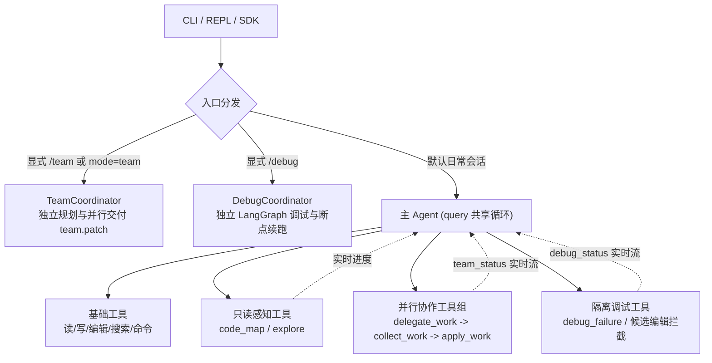
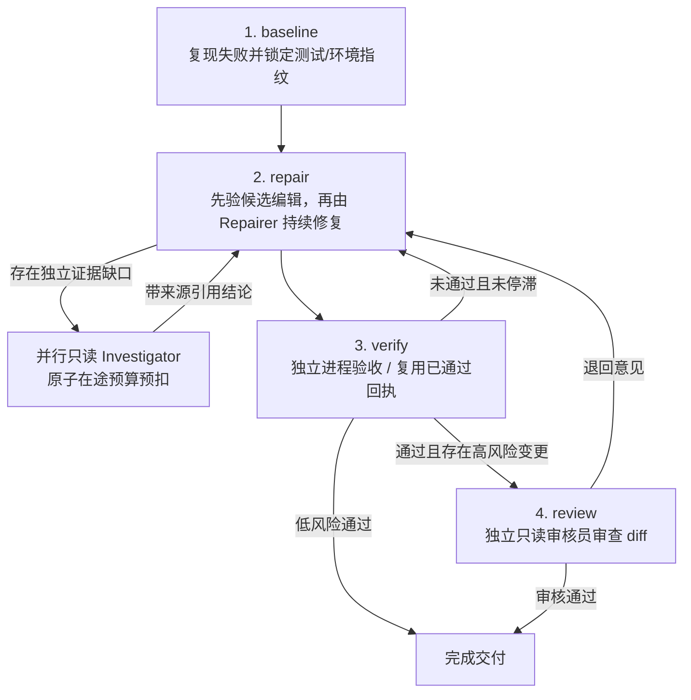

# PaiCLI

**在终端里阅读代码、并行协作开发与测试驱动修复。**

[](pyproject.toml)
[](LICENSE)

PaiCLI 是一个面向代码工程任务的终端编程 Agent，提供交互式 REPL、命令行接口与 Python SDK。进入项目后可直接提问、阅读代码或发起多文件改动。默认会话由统一主 Agent 驱动，按需调用代码地图、并行只读调研、多 Agent 协作与测试驱动隔离修复等工具能力；同时也提供 `/team` 与 `/debug` 显式入口。

**核心技术**：Python、asyncio、LangGraph、Tool Calling、AST 静态分析、Git Worktree、MCP、SQLite/FTS5、FastEmbed（多语 E5）、pytest、Ruff、HTTPX。

[快速开始](#快速开始) · [架构与执行链路](#架构与执行链路) · [Team 并行协作](#team-并行协作) · [Debug 工作流](#debug-工作流) · [代码向 Harness](#代码向-harness) · [评测与测试](#评测与测试) · [Python SDK](#python-sdk) · [项目结构](#项目结构)

## 可以做什么

| 能力 | 实现方式 |
| --- | --- |
| 代码地图与并行调研 | 零 LLM 成本的 `code_map` 提取全仓 AST 签名、导入图与反向调用方；`explore` 按需并发拉起 1–4 路只读子 Agent 隔离调研 |
| 多 Agent 并行协作 | 主 Agent 通过 `delegate_work / collect_work / apply_work` 分工，Worker 在独立 Git worktree 中并行开发并自测，合并验收通过后带乐观锁落盘 |
| 测试驱动隔离修复 | `DebugCoordinator`（LangGraph 状态机）固定测试与解释器指纹，在隔离 worktree 中完成复现、修复、独立验收与高风险审核 |
| 代码向 Harness | 写后即时语法与 Diff-Scoped Ruff 检查、AST 公开接口变更调用方提醒、读后写新鲜度校验、反死循环与交付前测试门禁 |
| 缓存与上下文控制 | 动静分离 Prompt 与跨 Worker 统一前缀目录稳定 KV Prefix Cache；完整工具批次滑动窗口、提取式摘要与 HTTP 连接池复用 |
| 可回查证据与预算 | 原始工具输出、事件流与测试结果落盘至 `.paicli/runs/`；支持预算控制、阶段 Checkpoint 与运行取消 |
| 项目资料检索（RAG） | 本地多语 E5 向量 + SQLite FTS5/BM25 与 RRF 融合检索规范与排障手册，存在 `.paicli/knowledge.db` 时 Debug 自动接入 |
| 工具与生态扩展 | 内置读写、精确编辑、搜索与命令工具，支持 MCP Client/Server 与按项目隔离的 SQLite 记忆 |

## 快速开始

需要 Python 3.11 或以上版本及 [uv](https://docs.astral.sh/uv/)。以下命令在仓库根目录使用 PowerShell 运行。

```powershell
git clone https://github.com/dbfbd/paicli-python.git
cd paicli-python
uv sync --locked --extra dev
$env:DEEPSEEK_API_KEY = 'your-key'
uv run --locked --extra dev paicli doctor
```

默认使用 DeepSeek，模型与预算等选项可在用户级 `~/.paicli/config.json` 或目标项目 `.paicli/config.json` 中配置。

### 交互会话与单次执行

```powershell
# 启动交互终端
uv run --locked --extra dev paicli --cwd ../your-project

# 非交互单次执行（-y 自动审批写操作与检查命令）
uv run --locked --extra dev paicli -p "修复 utils/slug.py 的连续连字符边界问题并跑测试" --cwd ../your-project -y
```

交互终端示例：

```text
概述这个项目的模块和入口
先梳理 tenant_id 的调用路径和相关测试，再同步更新所有服务入口
/team 并行实现 CSV、JSONL 和 KV 解析模块，各自自测并统一集成验收
请复现并修复 tests/test_example.py::test_case，保持 tests/test_example.py 中其他通过的用例
/help
```

隔离修复与多 Agent 协作需要目标项目已有 Git 提交。目标项目存在 `.venv` 时，测试与静态检查自动优先解析并使用该虚拟环境。

## 架构与执行链路

日常对话和 SDK 的 `ask()` 统一由主 Agent（`Agent._run_react`）在共享的 `query()` 循环中驱动。高阶能力以工具形式装配给主 Agent，按事实按需调用，不再由外层分类器预先切换模式；子流程进度通过异步事件队列实时透传至终端。

- **两级只读感知**：`code_map` 与 `explore` 常驻可用（可通过配置 `{"plan": {"auto_route": false}}` 关闭）。主 Agent 先用零成本 `code_map` 定位符号、依赖与测试，遇大仓库多子系统深读时再调 `explore` 并行隔离调研。
- **多 Agent 协作**：主 Agent 判断任务包含 2 个及以上可独立开发的模块时，通过 `delegate_work` 在后台启动并行 Worker，同时自己在前台处理公共入口文件，随后 `collect_work` 合并验收、`apply_work` 落盘。
- **条件触发 Debug**：主 Agent 运行 `pytest` 观测到测试失败后自动解锁 `debug_failure` 工具；若用户点名了具体失败用例且已复现，主 Agent 发起的源码编辑会携候选修改自动转入隔离 worktree 的 `DebugCoordinator` 验收，通过后才回写主工作区。



## Team 并行协作

多 Agent 协作既可在主会话由主 Agent 随时委派（`Collaboration`），也可通过 `/team` 或 SDK `engine.team()` 显式启动（`TeamCoordinator`），底层复用同一套 `_TeamRun`、Git worktree 与验收引擎：

- **文件独占与隔离 worktree**：每个 Worker 在独立 Git worktree 中只允许修改分配给自己的路径，避免并行写冲突；Git 阻塞操作运行在线程池中并由可重入锁保护。
- **跨 Worker 前缀缓存与反失忆**：所有 Worker 共享一致的 `shared_context` 头部前缀与统一仓库根路径上下文，提升跨 Worker KV Prefix Cache 命中率；队友消息与状态更新持久化追加到对话历史。
- **结构化看板与依赖流水线**：`TeamBoard` 管理依赖就绪、提前骨架发布（`publishes`）、修改请求（`request_team_change`）、邮箱查询（`read_team_mailbox`）与事件驱动等待（`wait_for_team_update`）；已完成队友支持按请求重开并自动注入依赖补丁。
- **两级测试与精准返修**：Worker 可用 `run_pytest` / `run_task_check` 在复用检查副本中局部自测；`collect_work` 合并所有 Worker 补丁与主 Agent 本地改动跑组合检查（省略 `checks` 时自动按测试目录推断）。失败项若归属特定 `owner`，直接唤醒对应 Worker 返修；全部通过后带主工作区哈希校验（乐观锁）应用补丁。

可在项目配置 `team` 节点下调整 `max_active_workers`、`max_worker_turns`、`max_model_calls`、`max_tokens` 与 `timeout`。

## Debug 工作流

`DebugCoordinator` 是系统中唯一保留 LangGraph 状态机的模块，用于承载带环路回溯、阶段 Checkpoint 和防篡改契约的受控调试：



- **不可篡改验收契约**：`create_baseline` 锁定测试文件、配置、依赖清单及 Python 解释器包环境指纹；`verify_run` 在独立子进程运行 pytest 并解析 JUnit，严格校验目标失败用例转绿（F2P）、原通过用例零回归（P2P）且受保护文件未改动。
- **过程加速与配额控制**：主会话传入的 `proposed_edit` 独立预检，不消耗 Repairer 的 `max_attempts`；`_run_tests` 已通过且工作区指纹未变时，`_verify` 直接复用收据避免重复执行 pytest；文件指纹与解释器探针均带失效保护缓存。
- **运行记录与取消**：

```powershell
uv run --locked --extra dev paicli runs list
uv run --locked --extra dev paicli runs show RUN_ID
uv run --locked --extra dev paicli runs cancel RUN_ID
```

也可脱离 Agent 单独使用同一套基线与验收命令：

```powershell
uv run --locked --extra dev paicli verify baseline tests/test_example.py --cwd ../your-project --json
uv run --locked --extra dev paicli verify check BASELINE_RUN_ID --json
```

## 代码向 Harness

除 Debug 专用契约外，主会话与子 Agent 共享四层代码工程护栏：

1. **写后即时静态反馈（`lsp/diagnostics.py`）**：写入或编辑 `.py` 文件后立即执行语法编译检查、Diff-Scoped `ruff`（仅报告本次编辑新引入的 `E9/F63/F7/F82/F401` 严重错误）以及 AST 顶层公开接口变更的静态调用方提醒。
2. **过程一致性与防空转**：`ToolContext` 记录读取文件时的 `(mtime_ns, size)`，编辑前拦截外部变更；共享 `query()` 检测同参数连续失败并自动注入转向提示，同时支持 `max_tokens` 输出截断自动拆步恢复。
3. **交付前验证门禁**：主会话修改 `.py` 源码后若未运行测试（或测后又修改），结束前通过 `before_finish` 提醒补跑验证。
4. **安全与恢复**：路径与命令守卫、写时延迟异步快照（按上限自动裁剪）以及非交互缺少审批回调时的快速失败保护。

## 项目资料检索

需要参考项目规范、接口约定或排障手册时，可建立本地资料索引：

```powershell
uv sync --locked --extra dev --extra retrieval
uv run --locked --extra dev --extra retrieval paicli knowledge index docs --cwd ../your-project
uv run --locked --extra dev --extra retrieval paicli knowledge search '重复请求如何处理' --cwd ../your-project --k 3
```

索引保存在目标项目 `.paicli/knowledge.db`。存在索引时，主会话进入隔离 Debug 会自动开启资料检索，并对命中片段校验当前文件哈希。

## 评测与测试

仓库内置单元测试与分层评测框架：

- **自动化测试（`tests/`）**：覆盖核心执行循环、KV 缓存稳定性、截断恢复、工作区与看板协作、静态诊断、新鲜度/反死循环、Debug 收据复用以及评测夹具校验。
- **分层基准评测（`evals/`）**：包含 A/B/C/D 四套 12 道独立 Git 仓库任务（单文件直达、22–25 文件跨层重构与排障、多模块并行开发与只读审计、回归陷阱与规范调试），配备公开/隐藏双层测试、防测试篡改打分器、`minimal_react` 极简对照基线及跨次结果对比脚本。

### 实测基准汇总（37 题 / 117 次运行）

统一使用 `deepseek-flash`、`max_tokens=4096` 与隔离临时工作区执行（公开基准统一上限 `max_turns=25`、单题超时 `240s`）：

**1. 本地 12 题分层消融（`evals/`，42 次运行）**

| 配置 | Pass@1（含隐藏） | 公开测试 | 20+ 文件跨层重构（Suite B） | KV Cache 命中率 | 误路由 |
| --- | :---: | :---: | :---: | :---: | :---: |
| `minimal_react` | 9/12 (75.0%) | 10/12 | 105.2s / 306,981 tok | 89.2% | 0 |
| 旧版基线（`4330075`） | 9/12 (75.0%) | 10/12 | 68.4s / 193,736 tok | 79.6% | 0 |
| **当前版本（`main`）** | **10/12 (83.3%)** | **12/12** | **74.7s / 180,903 tok** | **83.1%** | **0** |

> 相比 `minimal_react`，Suite B 跨层任务通过 `code_map` 提速 **1.41×**、Token 降 **41.1%**；Suite C 多模块协作任务首次集成验收通过率 **3/3（100%）**，多 Worker 并行场景 KV 命中率由 `78.5%` 升至 **`86.5%`**。

**2. 公开 25 题 `SWE-bench Verified` 子集三方对比（75 次运行）**

样本覆盖 `django/django`（10）、`sympy/sympy`（13）、`psf/requests`（1）、`pallets/flask`（1），均经本地 Python 3.13 金补丁预验，仅提取非测试源码 `git diff` 注入干净快照并执行官方 `F2P/P2P` 判分：

| 对比对象 | Resolved@1 | 无超限干净收敛 | 触顶/超时次数 | 均耗 / P95 (s) | 输出 Token | KV 命中率 |
| --- | :---: | :---: | :---: | :---: | :---: | :---: |
| 旧版基线（`4330075`） | 22/25 (88.0%) | 17/25 (68.0%) | 6 | 114.2 / 174.0 | 149,112 | 92.1% |
| `mini-swe-agent`（`v2.4.6`） | 22/25 (88.0%) | 19/25 (76.0%) | 5 | 102.9 / 184.6 | 139,295 | 92.3% |
| **当前版本（`main`）** | **23/25 (92.0%)** | **22/25 (88.0%)** | **1** | **98.5 / 144.6** | **139,190** | **92.2%** |

> 相对旧版，端到端均耗降 **13.7%**、输出 Token 降 **6.7%**、P95 尾延迟降 **16.9%**；相对 `mini-swe-agent`，无超限干净收敛率高 **12.0pp**、P95 尾延迟降 **21.7%**。

```powershell
# 运行静态检查与全部单元测试
uv run --locked --extra dev ruff check src evals tests
uv run --locked --extra dev pytest -v

# 运行指定套件消融评测并对比两次结果
uv run --locked --extra dev python -m evals.runner --label run_a --suites A B C D --modes minimal_react paicli_full
uv run --locked --extra dev python -m evals.compare evals/results/run_a.json evals/results/run_b.json
```

## Python SDK

```python
import asyncio

from paicli.sdk import create_default_engine


async def main():
    engine = create_default_engine(cwd="../your-project", auto_approve=True)
    result = await engine.ask_complete_async("概述这个项目的模块和入口")
    print(result.text)


asyncio.run(main())
```

`engine.ask()` 与 `engine.team()` 返回异步事件流；支持传入 `approval_callback` 或 `auto_approve=True` 控制非交互审批。

## 可选 Runtime 服务与 MCP

- **HTTP Runtime**：支持通过 SQLite 持久化队列提交普通任务和 Team 任务。

```powershell
$env:PAICLI_RUNTIME_API_KEY = 'your-runtime-key'
uv run --locked --extra dev paicli serve --cwd ../your-project --port 8080
```

提供 `/v1/threads` 与 `/v1/tasks` 接口（Bearer 鉴权），也可单独运行 `paicli worker --cwd ../your-project --workers 2`。

- **MCP**：读取用户级或项目级 `.paicli/mcp.json`，可通过 `paicli mcp list` 查看配置，或通过 `paicli mcp serve --transport stdio` 对外暴露内置工具。

## 项目结构

```text
src/paicli/
├── agent/         统一主脑、共享 query 循环、Explore、Collaboration/Team 与 Debug 状态机
├── harness/       AST 代码地图、环境解析、任务契约、证据链、pytest 验收与预算控制
├── lsp/           写后语法检查、Diff-Scoped Ruff 诊断与 AST 接口变更提示
├── context/       请求预算、工具边界对齐滑动窗口与历史摘要
├── prompt/        静态系统前缀与动态轮次上下文组装
├── llm/           OpenAI 兼容流式客户端、长连接池与计费配置
├── memory/        按项目隔离的 SQLite 持久记忆与召回缓存
├── rag/           本地多语 E5 + FTS5 混合资料检索
├── tools/         内置工具、别名去重注册表与并发分组执行器
├── policy/        路径守卫、命令守卫与审计日志
├── snapshot/      写时延迟异步快照与保留裁剪
├── mcp/           MCP Client 与 Server
├── runtime/       HTTP 服务接口与 SQLite 任务队列
├── render/        终端流式渲染器
├── entrypoints/   CLI、REPL 与子命令
└── sdk.py         Python SDK 入口

evals/             4 套 12 题分层评测任务、防篡改打分器、对照基线与对比脚本
tests/             核心运行时、多 Agent 协作、代码 Harness 与评测夹具单元测试
```

## 适用范围

- Debug 与静态代码地图主要面向具备可复现 pytest 测试的本地 Python Git 仓库。
- 项目资料检索面向中小型本地文档库，向量保存在 SQLite 并做有界精确检索。
- 权限、审批、预算与证据约束按对应入口生效，多 Agent 协作与隔离修复均要求目标项目已完成 Git 初始化提交。

## 许可证

本项目采用 [MIT License](LICENSE)。
